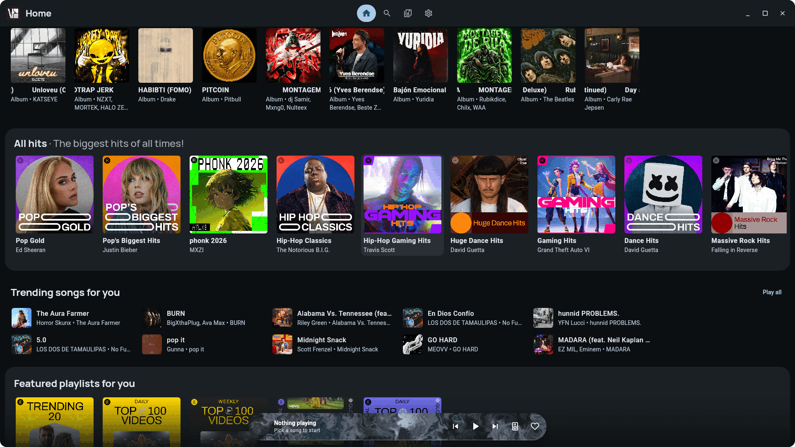
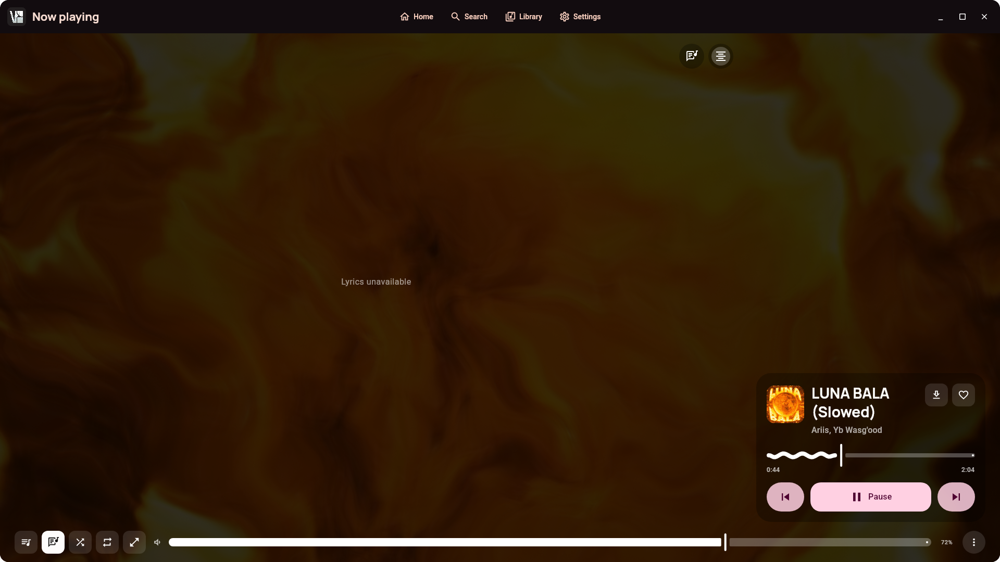
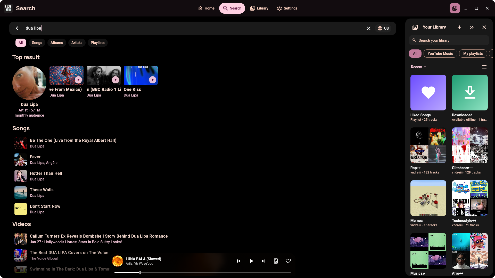
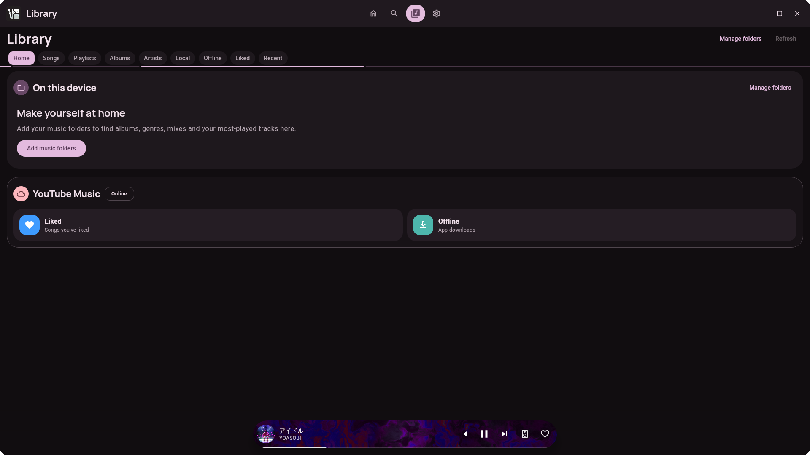

<p align="center">
  
</p>

<h1 align="center">VIsage</h1>

<p align="center">
  A desktop music player for YouTube Music. It runs on Windows and Linux.
</p>

<p align="center">
  <a href="https://github.com/vndreiii/visage-music/actions/workflows/ci.yml"></a>
  <a href="https://ko-fi.com/vndreiii"></a>
</p>

<p align="center">
  
</p>

<table>
  <tr>
    <td width="33%"></td>
    <td width="33%"></td>
    <td width="33%"></td>
  </tr>
</table>

## Features

- Browse Home, Search, artists, albums and playlists from your YouTube Music account.
- Play local music folders. A Rust helper scans the files and edits their tags.
- Show synced lyrics, with word-by-word highlighting.
- Show animated Canvas covers and music videos.
- Save songs for offline use.
- Use the keyboard and media keys. Linux supports MPRIS.
- Update itself (AppImage and Windows installer).

## Install

Download a file from the [Releases page](https://github.com/vndreiii/visage-music/releases).

| System | File |
|--------|------|
| Windows, installer | `VIsage-x64.msi` or `VIsage-<version>-windows-x64-setup.exe` |
| Windows, portable | `VIsage-<version>-windows-x64-portable.zip` (unzip and run `VIsage.exe`) |
| Any Linux | `VIsage-x86_64.AppImage` or `VIsage-aarch64.AppImage` |
| Debian, Ubuntu | `.deb` |
| Fedora, openSUSE | `.rpm` |
| Arch Linux | `PKGBUILD` (installs the release) or `packaging/arch/PKGBUILD` (builds from source) |
| Other | `.tar.gz` or Flatpak |

Windows builds include libmpv and yt-dlp.

On Linux, install **libmpv** (package `mpv` or `libmpv2`). Install **yt-dlp** for the stream fallback and for offline saves.

## Build from source

You need **JDK 21** and **Rust**.

```bash
# Run in development
./gradlew :composeApp:run

# Build the Linux packages into dist/
scripts/package-linux.sh
```

```powershell
# Build the Windows packages into dist\
.\scripts\package-windows.ps1
```

The Windows build also needs WiX Toolset 3, 7-Zip and the GitHub CLI.

## Documentation

- [Architecture](docs/architecture.md)
- [UI kit](docs/ui-kit.md)

## Support

VIsage is free. You can [support the project on Ko-fi](https://ko-fi.com/vndreiii).

## License

VIsage uses the **GPL-3.0** license. See [`LICENSE`](LICENSE).
VIsage comes from [VIVI Music](https://github.com/vivizzz007/vivi-music) and keeps its license terms.
VIsage has no affiliation with YouTube or Google. YouTube Music is a trademark of Google LLC.
