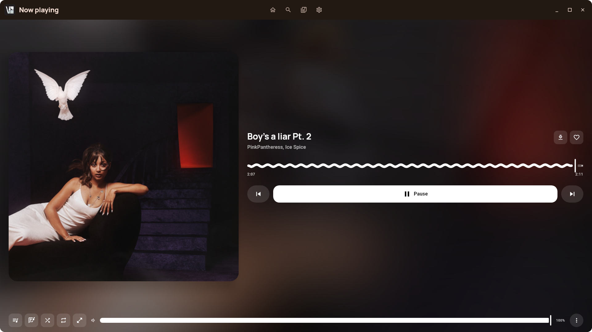
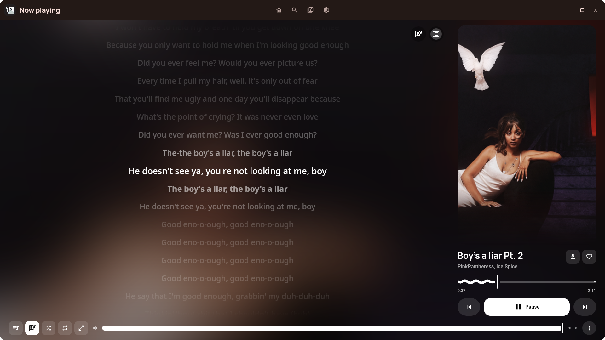
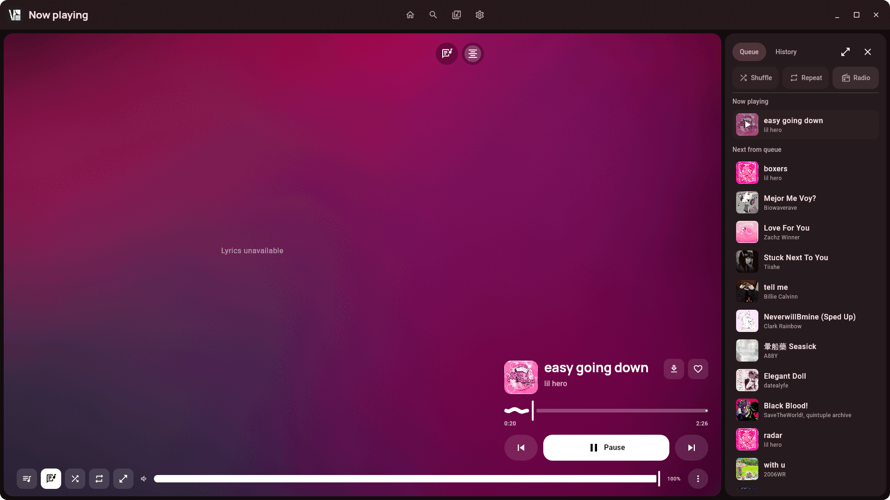
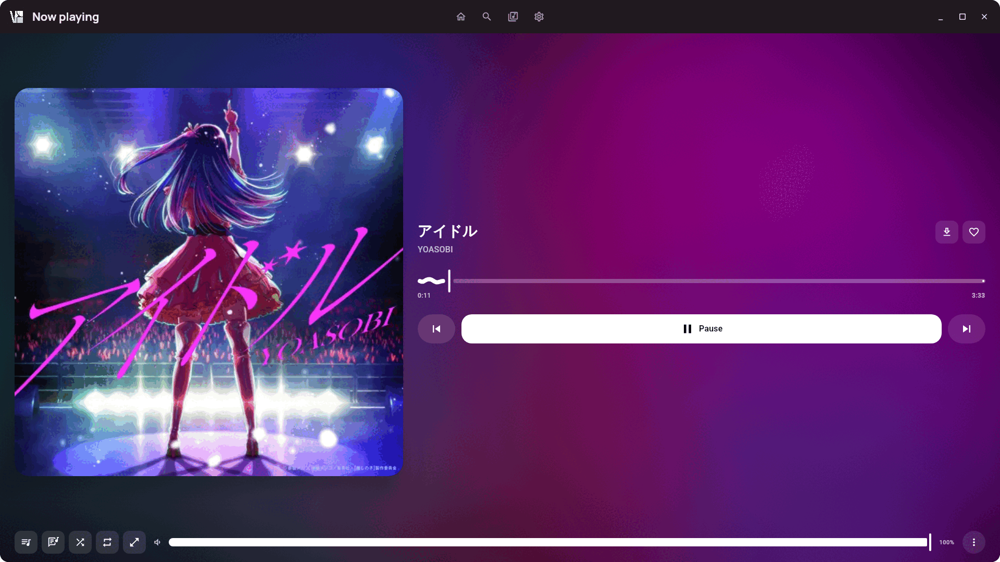
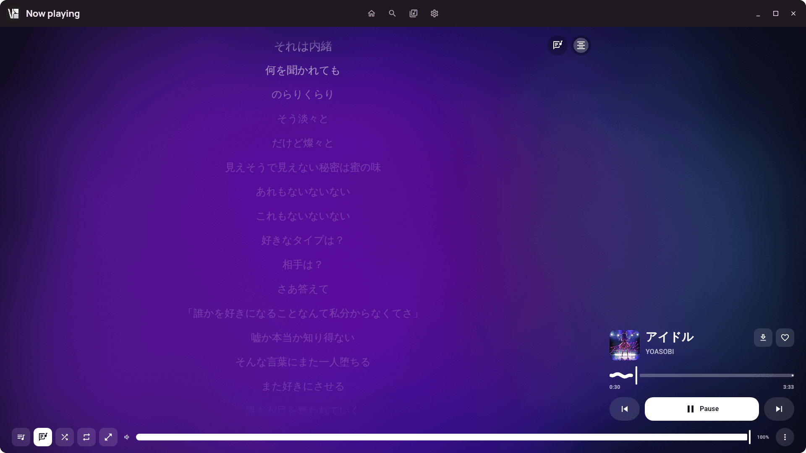
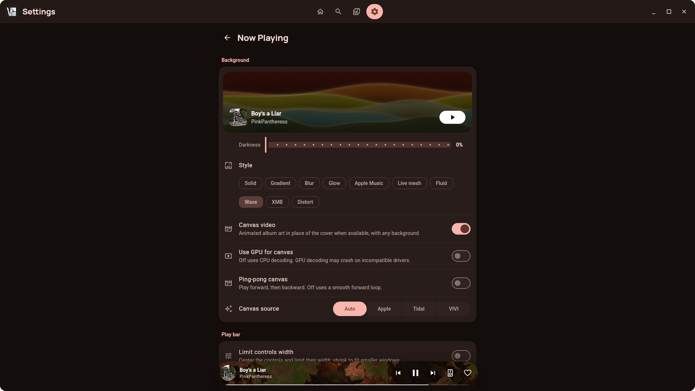
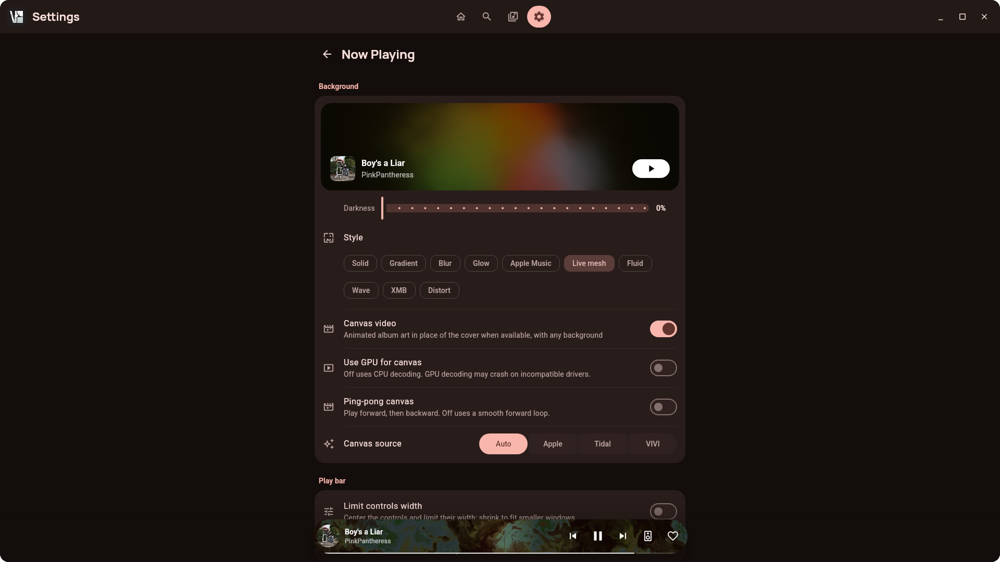

<p align="center">
  
</p>

<h1 align="center">VIsage</h1>

<p align="center">
  A Linux desktop player for YouTube Music. Desktop port of <a href="https://github.com/vivizzz007/vivi-music">VIVI Music</a>.
</p>

<p align="center">
  <a href="https://github.com/vndreiii/visage-music/actions/workflows/ci.yml"></a>
</p>

## Screenshots

<table>
  <tr>
    <td width="50%"><br><sub><b>Home</b>: shelves, quick picks and charts</sub></td>
    <td width="50%"><br><sub><b>Search</b>: songs, videos, albums and playlists</sub></td>
  </tr>
  <tr>
    <td width="50%"><br><sub><b>Library</b>: local folders, liked songs and offline saves</sub></td>
    <td width="50%"><br><sub><b>Now Playing</b>: animated Canvas cover art, with a wavy seek bar</sub></td>
  </tr>
  <tr>
    <td width="50%"><br><sub><b>Synced lyrics</b>: the current line is highlighted, canvas still playing in the cover card</sub></td>
    <td width="50%"><br><sub><b>Queue</b>: pinned rail with queue and radio controls</sub></td>
  </tr>
  <tr>
    <td width="50%"><br><sub><b>Now Playing</b>: artwork-driven background</sub></td>
    <td width="50%"><br><sub><b>Lyrics</b> on a Japanese track, with the line highlighted</sub></td>
  </tr>
  <tr>
    <td width="50%"><br><sub><b>Background style</b>: Wave</sub></td>
    <td width="50%"><br><sub><b>Background style</b>: Live mesh</sub></td>
  </tr>
</table>

## Features

- **Browse**: Home shelves, Search, artists, albums and playlists from your YouTube Music account
- **Library**: local music folders with a Rust scan and fuzzy-search helper, plus liked songs and offline saves
- **Playback**: libmpv engine, queue and radio, shuffle and repeat
- **Lyrics**: synced lyrics from LRCLIB and other providers
- **Now Playing**: Canvas looping video backgrounds and shader backgrounds, with a pinnable queue rail
- **Desktop integration**: MPRIS for media keys and shell applets
- **Offline**: save tracks as audio files via yt-dlp into your Downloads folder
- **UI**: Material 3 Expressive components and dynamic color
- **Sign-in**: embedded Chromium, so you sign in with Google inside the app
- **Updates**: signed auto-update for the AppImage; other formats link to the release page

## Install

Download the latest build from the [Releases page](https://github.com/vndreiii/visage-music/releases):

- `.deb` (Debian, Ubuntu)
- `.rpm` (Fedora, openSUSE)
- `.tar.gz` (portable)
- `VIsage-x86_64.AppImage` (any distro, self-updating)
- Flatpak

You need **libmpv** installed. VIsage uses a Secret Service keyring (GNOME Keyring, KWallet, etc.) for your session; if none is available, it falls back to an encrypted file.

## Build from source

Requires **JDK 21**. Gradle fetches a JDK if needed, and the first build needs internet access.

```bash
# Run in development
./run-dev.sh            # or: ./gradlew :composeApp:run

# Optional: Rust helpers (scan and search), loaded through JNA
cargo build --release --manifest-path native/Cargo.toml

# Linux packages (.deb, .rpm, .tar.gz, AppImage) into dist/
scripts/package-linux.sh
```

## Project layout

| Path | Role |
|------|------|
| `composeApp/` | Compose Multiplatform desktop UI |
| `player/` | Playback controller, libmpv, MPRIS, stream resolution, session storage |
| `innertube/` | YouTube Music Innertube API client |
| `core/` | DI, session and service facades |
| `database/` | Local SQLDelight cache |
| `native/` | Optional Rust helpers for library scan and fuzzy search |

More detail: [`docs/architecture.md`](docs/architecture.md). Reusable UI pieces (motion tokens, Material 3 Expressive components, shader backgrounds): [`docs/ui-kit.md`](docs/ui-kit.md).

## Upgrading from VIVI Desktop

Your data is migrated automatically on first launch. The window class is now `visage`, so update any compositor rules that matched the old class.

## Credits and license

VIsage is licensed under the **GPL-3.0**; see [`LICENSE`](LICENSE). It is derived from [VIVI Music](https://github.com/vivizzz007/vivi-music) and inherits its license terms.

VIsage is not affiliated with, endorsed by, or sponsored by YouTube or Google. YouTube Music is a trademark of Google LLC.
