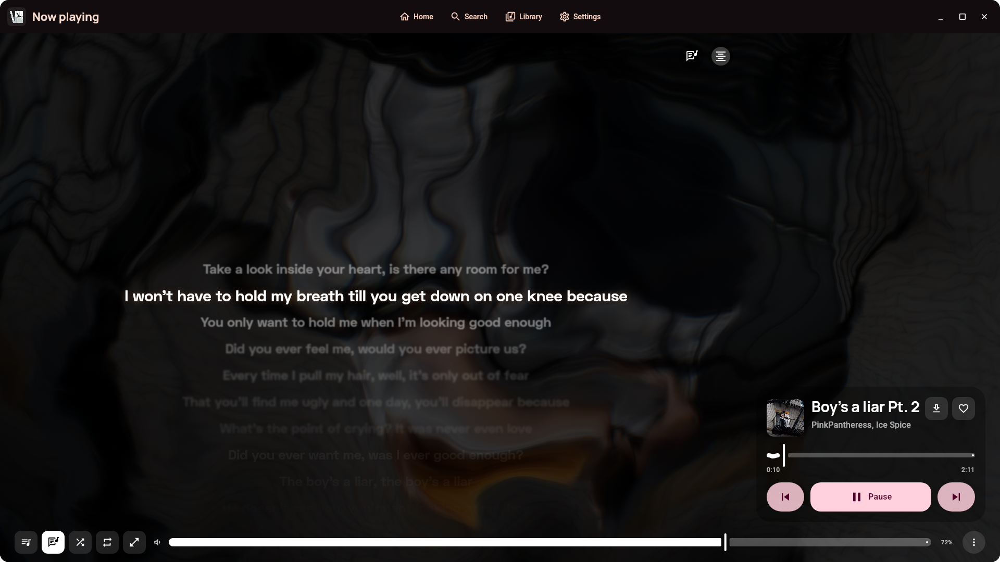

<p align="center">
  
</p>

<h1 align="center">VIsage</h1>

<p align="center">A desktop music player for YouTube Music, on Linux and Windows.</p>

<p align="center">
  <a href="https://github.com/vndreiii/visage-music/releases/latest"></a>
  <a href="https://github.com/vndreiii/visage-music/actions/workflows/ci.yml"></a>
  
  <a href="https://ko-fi.com/vndreiii"></a>
</p>

<p align="center">
  <a href="https://github.com/vndreiii/visage-music/releases/latest"><b>Download</b></a> ·
  <a href="https://ko-fi.com/vndreiii"><b>Support</b></a> ·
  <a href="docs/architecture.md"><b>Architecture</b></a>
</p>

<p align="center">
  
</p>

---

## Features

- **Browse.** See Home, Search, artists, albums and playlists from your YouTube Music account.
- **Local music.** Play your music folders. A Rust helper scans the files and edits their tags.
- **Lyrics.** Read synced lyrics, with word-by-word highlighting. If one provider fails, VIsage asks the next one.
- **Now Playing.** See animated Canvas covers and music videos. Change how the player moves when the song changes.
- **Sidebars.** Keep the queue on one side and your library on the other.
- **Offline.** Save songs to your disk.
- **Keyboard.** Control the player with keys. Change any key in Settings.
- **Colours.** The app uses Material 3 Expressive and dynamic colour.
- **Updates.** The AppImage and the Windows installer update themselves. Each update is signed.

<p align="center">
  
  
</p>

<p align="center">
  
</p>

## Download

Get the latest version from the [Releases page](https://github.com/vndreiii/visage-music/releases/latest).

| Platform | File | How to install |
|---|---|---|
| Linux (all distributions) | `VIsage-x86_64.AppImage` or `VIsage-aarch64.AppImage` | Run `chmod +x` on the file. Then run it. |
| Debian, Ubuntu | `visage_<version>_amd64.deb` | Run `sudo apt install ./` with the file. |
| Fedora, openSUSE | `visage-<version>-1.x86_64.rpm` | Run `sudo dnf install` with the file. |
| Arch Linux | `PKGBUILD` | Put the file in an empty folder. Run `makepkg -si`. |
| Linux (other) | `visage-<version>-linux-<arch>.tar.gz` | Unpack the file. Run `visage/bin/visage`. |
| Windows 10 and 11 | `VIsage-x64.msi` or `VIsage-<version>-windows-x64-setup.exe` | Run the installer. You do not need administrator rights. |
| Windows 10 and 11 (portable) | `VIsage-<version>-windows-x64-portable.zip` | Unzip the file anywhere. Run `VIsage.exe`. |

The Windows files include libmpv and yt-dlp.
On NixOS, `appimage-run` does not include libmpv. Install `mpv-unwrapped` and set `VISAGE_LIBMPV` to the full path of its `libmpv.so.2`, for example:

```bash
VISAGE_LIBMPV=$(nix-build '<nixpkgs>' -A mpv-unwrapped --no-out-link)/lib/libmpv.so.2 appimage-run VIsage-x86_64.AppImage
```

On Linux, install **libmpv** (the `mpv` or `libmpv2` package). Install **yt-dlp** to save songs and to use the stream fallback.

## Build from source

You need **JDK 21** and **Rust**.

```bash
./gradlew :composeApp:run        # run the app
scripts/package-linux.sh         # make the Linux packages in dist/
```

On Arch Linux, build the package:

```bash
cd packaging/arch && makepkg -si
```

On Windows, use PowerShell. You also need WiX Toolset 3, 7-Zip and the GitHub CLI:

```powershell
.\scripts\package-windows.ps1    # makes the .zip, .msi and .exe in dist\
```

## Links

- Releases: <https://github.com/vndreiii/visage-music/releases>
- Support: <https://ko-fi.com/vndreiii>
- Architecture: [docs/architecture.md](docs/architecture.md)
- UI kit: [docs/ui-kit.md](docs/ui-kit.md)

## License

VIsage uses the **GPL-3.0** license. See [`LICENSE`](LICENSE).
VIsage comes from [VIVI Music](https://github.com/vivizzz007/vivi-music) and keeps its license terms.
VIsage has no affiliation with YouTube or Google. YouTube Music is a trademark of Google LLC.
